# Diablo Resurrected · Alpha I

> **Early playtest.** Alpha I has had limited testing. You may encounter bugs, performance issues, or hardware compatibility problems. If something goes wrong, please [report what happened](#report-a-bug).

An unofficial fan project for the original **Diablo**. Return to Tristram, descend all sixteen dungeon floors, and face Diablo in Hell. Press **G** mid-fight to switch between classic graphics and the new 3D world. The fight keeps going.

[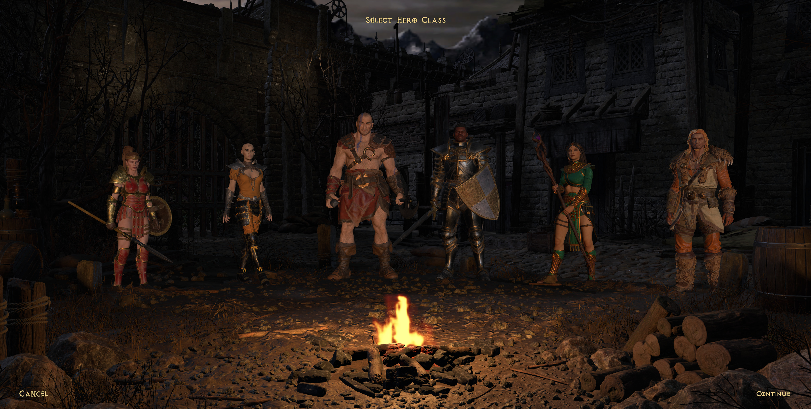](screenshots/camp.jpg)

## Join the Windows playtest

**[Download Alpha I for Windows](https://github.com/WordhordHearth/Diablo-Resurrected/releases/download/v0.1.0-alpha.13/Diablo-Resurrected-Setup.zip)** · 363 MiB. [Release notes](https://github.com/WordhordHearth/Diablo-Resurrected/releases/tag/v0.1.0-alpha.13) | [Join the Discord](https://discord.gg/EGKxgCJr6)

## Installation

1. Have the original **Diablo** installed. For modern graphics, also install **Diablo II: Resurrected**. **Hellfire** is optional. Modern graphics require a Vulkan-capable GPU. Minimum hardware is still being established during the alpha.
2. Extract the whole ZIP to a folder where you want to keep the game. Open **DiabloLauncher.exe** and choose **Setup**.
3. Select your Diablo folder containing `DIABDAT.MPQ`, your Hellfire folder if you own the expansion, and your Diablo II: Resurrected folder for modern graphics. Allow about half an hour for the first conversion. Slower PCs may take longer.
4. When the launcher says **Ready to Play**, choose **Play**. The game installs in the launcher's **Game** subfolder.

### Choose your game folders

Open **Setup** and use **Browse** beside each game you own. Your drive letter and library folders can differ from the examples below.

| Setup field | Example on Windows | How to recognize the folder |
|---|---|---|
| Diablo | `D:\Games\Classic\Diablo` | Open the folder containing **DIABDAT.MPQ**. In GOG Galaxy, select Diablo and use **Manage installation → Show folder**. |
| Hellfire (optional) | `D:\Games\Classic\Diablo\hellfire` | Open the folder containing **hellfire.mpq**, **hfmonk.mpq**, **hfmusic.mpq**, and **hfvoice.mpq**. Leave this field blank to play without Hellfire. |
| Diablo II: Resurrected (modern graphics) | `D:\Games\Diablo II Resurrected` | In Battle.net, select Diablo II: Resurrected and use the gear beside **Play → Show in Explorer**. Select the game folder one level above **Data**. It contains both **.build.info** and **Data**. |

[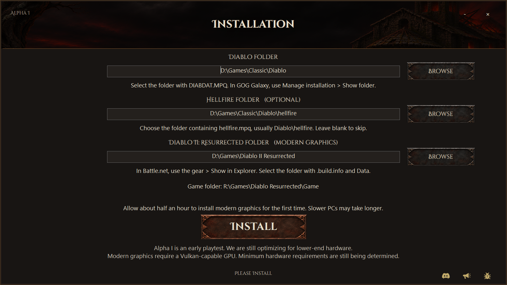](screenshots/launcher-folders.png)

### Ready to play

The launcher creates its own **Game** subfolder automatically. When installation finishes, the home screen shows **Ready To Play**. Choose **Play** to enter the game.

[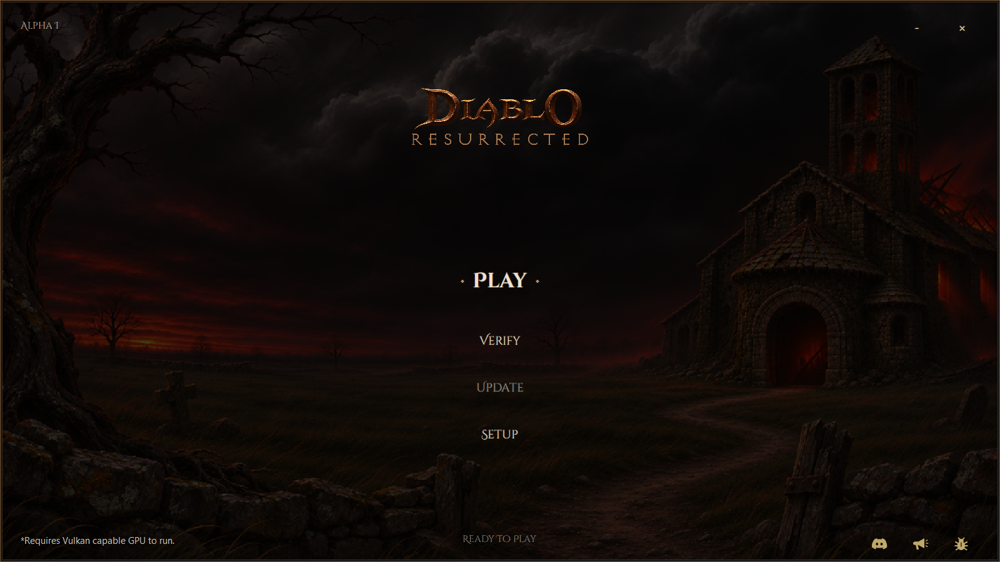](screenshots/launcher-play.png)

## Quality of life

Alpha I already includes dozens of quality-of-life improvements, with more planned. Here are a few you’ll notice as you play.
- Shop in a Diablo II–style grid. Browse Griswold’s stock and compare items with what you’re wearing.
- Organize your loot. Store gear across 100 stash pages and Ctrl-click to move items between your stash and inventory.
- Keep a second weapon set ready. Swap between two equipped sets, carry eight potions in a two-row belt, and set automatic gold pickup separately for town and dungeon.
- See what a stat does for your hero. Hover over an attribute to see its base value, cap, and class-specific effects.
- Choose how to cast. The quick spell picker distinguishes learned spells, class skills, staff charges, and scrolls.
- Choose your view. Zoom in up to 4×, press G to switch between classic and modern graphics during play, and press F4 to take a screenshot, including at the campfire.

## Known limitations

- Hardware support is still being tested. Modern graphics require a Vulkan-capable GPU. We’re still working on performance and haven’t established minimum hardware specs. If you report slowdowns, please include your GPU, resolution, and where they happened.
- The Caves can hitch. You may see brief pauses in lava-heavy areas. The lava flow itself also needs another visual pass.
- Some equipment looks different when worn. An item’s inventory icon and its equipped model can differ. If you find one, a screenshot with the inventory open lets us see both at once.
- Hellfire’s visual overhaul is incomplete. The original campaign’s sixteen floors are the focus of Alpha I. The Hive and Crypt still need further environment work.

## One dungeon, two views

The same spot on Cathedral floor 4, captured in both graphics modes.

| Classic | Modern |
|:---:|:---:|
| [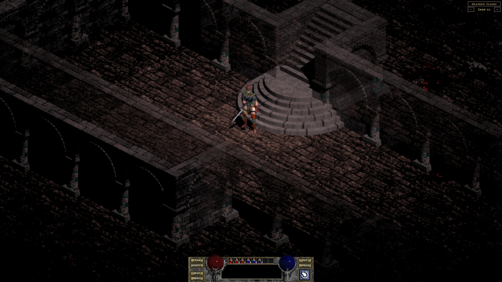](screenshots/cathedral-classic.jpg) | [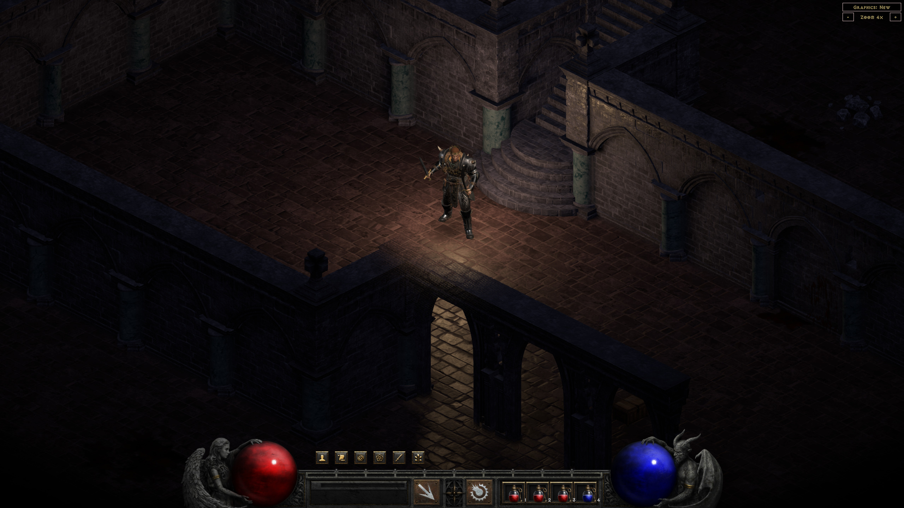](screenshots/cathedral-modern.jpg) |

## Beneath Tristram

| Cathedral · Bard | Catacombs · Rogue |
|:---:|:---:|
| [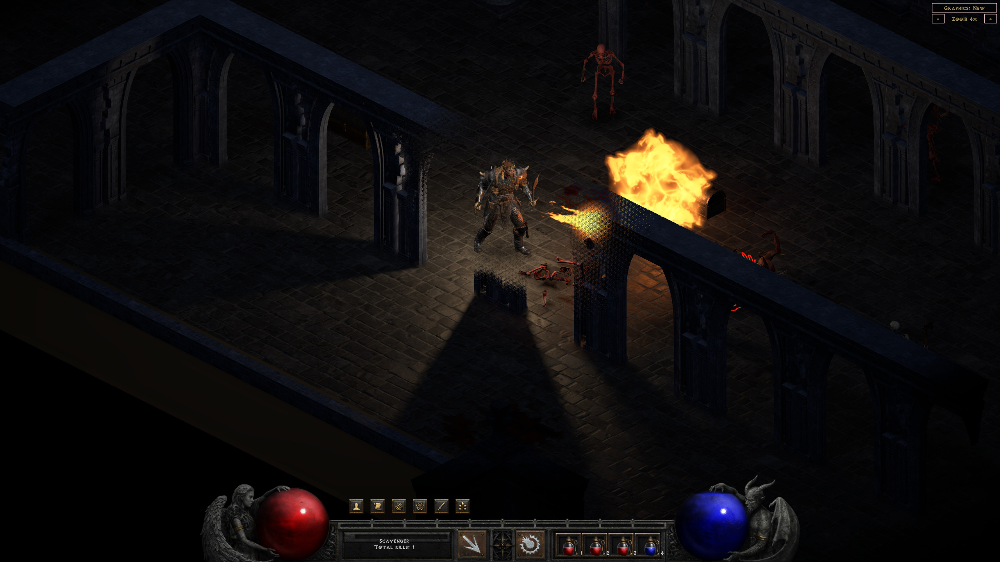](screenshots/cathedral.jpg) | [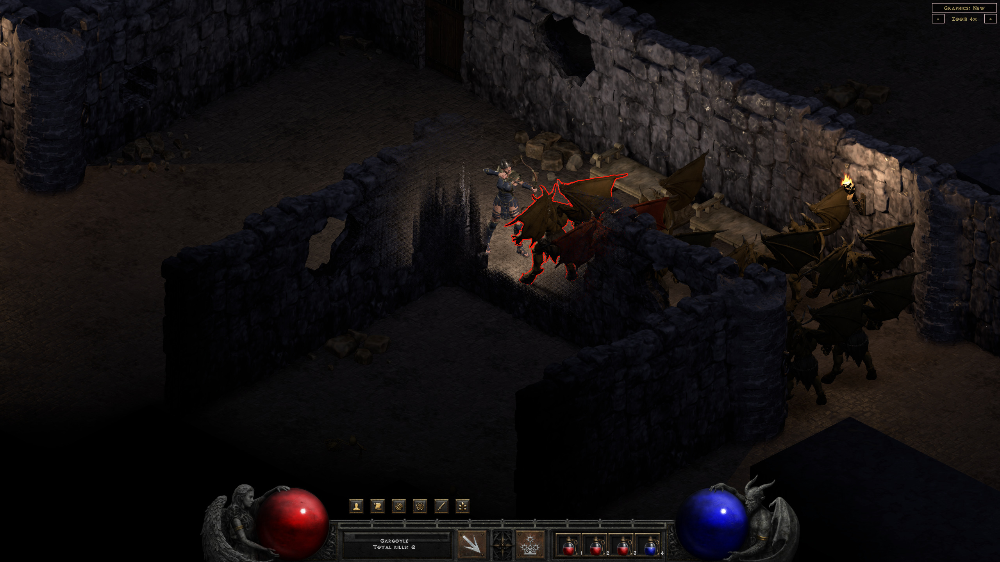](screenshots/catacombs.jpg) |

| Caves · Monk | Hell · Barbarian |
|:---:|:---:|
| [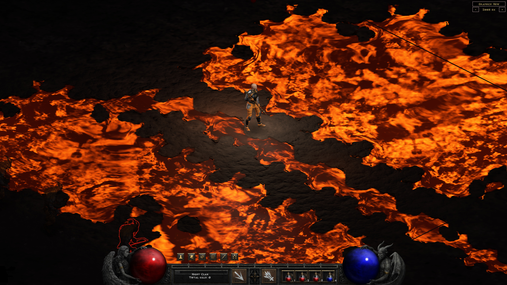](screenshots/D1R_Caves_Basic.png) | [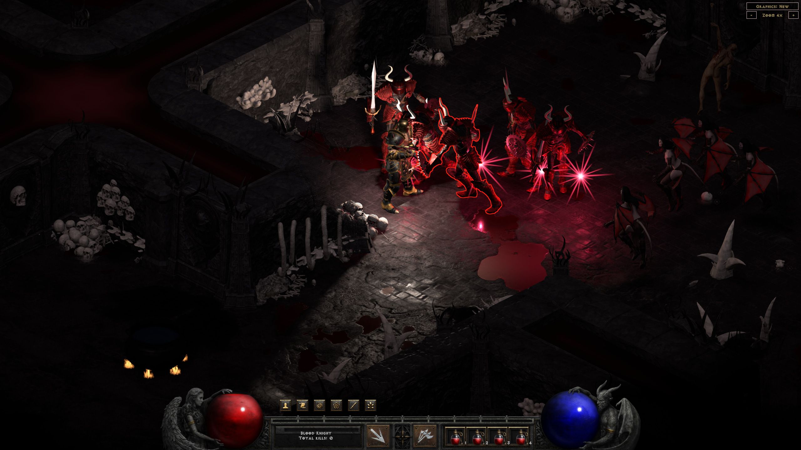](screenshots/hell.jpg) |

| The Butcher's room | The Skeleton King's tomb |
|:---:|:---:|
| [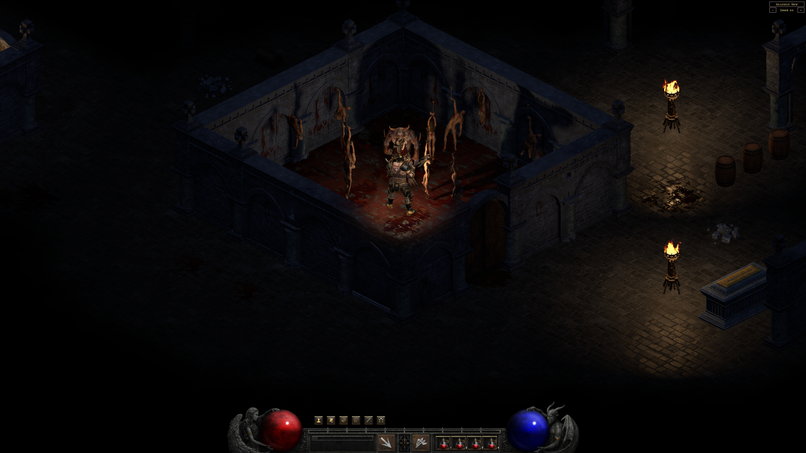](screenshots/butcher.jpg) | [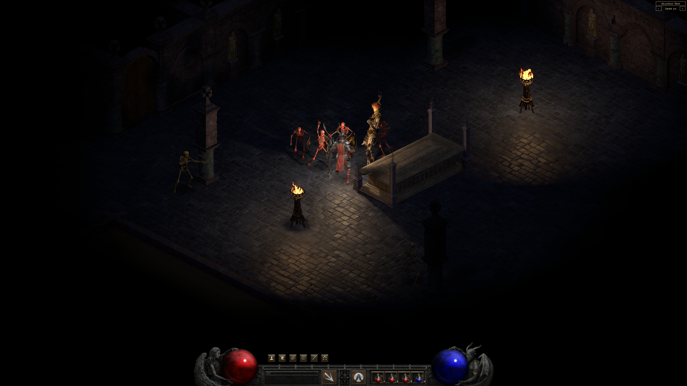](screenshots/leoric.jpg) |

## A Brief Starting Look

| Along the river | Trading at the forge |
|:---:|:---:|
| [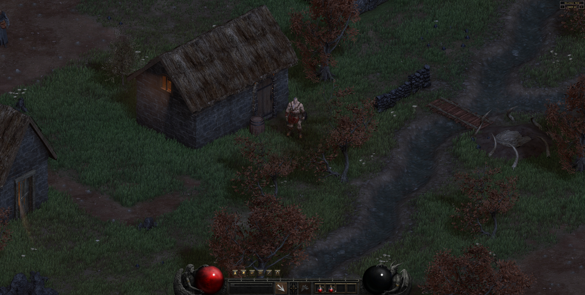](screenshots/barbarian-river.jpg) | [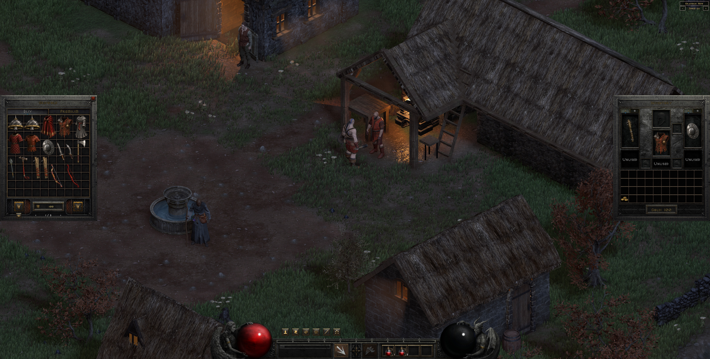](screenshots/barbarian-shop.jpg) |

| Into the Cathedral | First encounters |
|:---:|:---:|
| [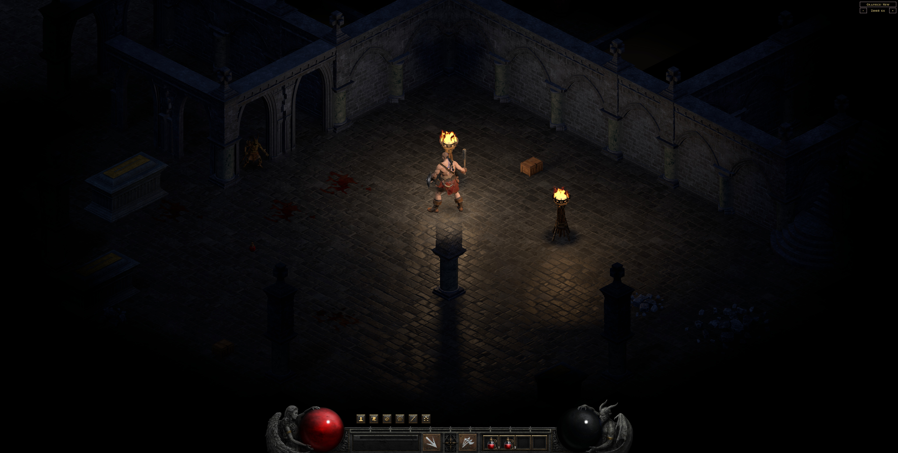](screenshots/barbarian-descent.jpg) | [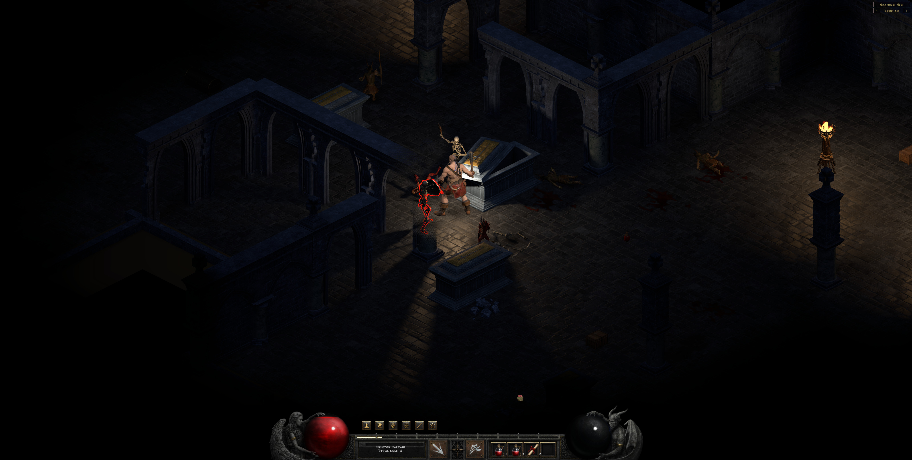](screenshots/barbarian-fight.jpg) |

## Between dungeon runs

Compare gear at Griswold's forge, preview a repair quote, and move loot between your inventory and a **100-page stash**. Swap between two weapon sets and carry eight potions in the expanded belt.

| Griswold's shop | Paged stash |
|:---:|:---:|
| [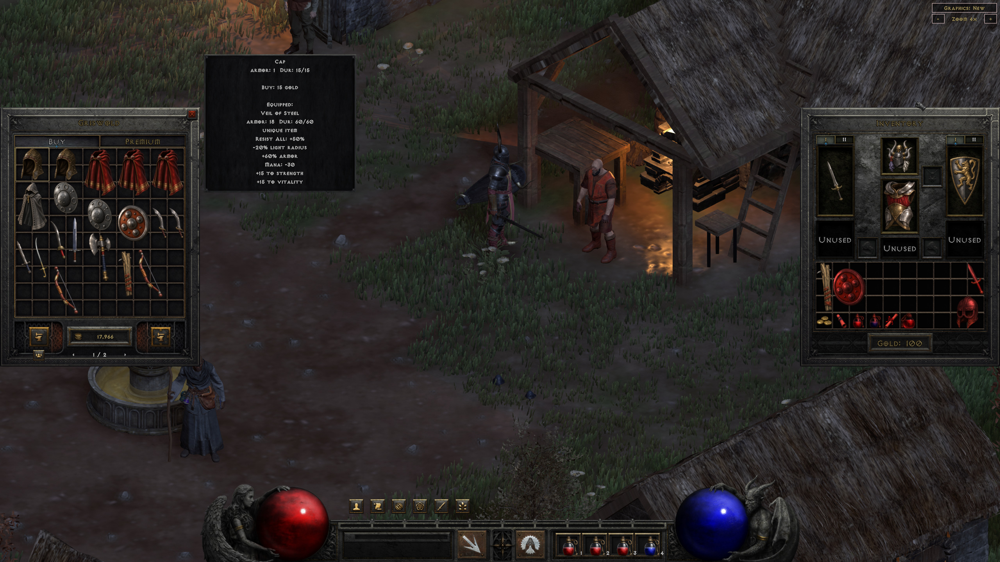](screenshots/forge.jpg) | [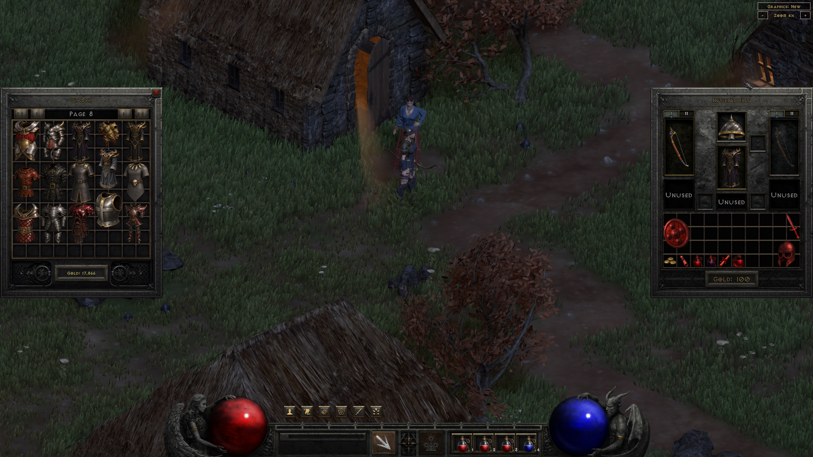](screenshots/stash.jpg) |

## Choose your rules

Create a Warrior, Rogue, or Sorcerer at the campfire. Hellfire adds the Monk, Bard, and Barbarian.

- **Solo Self-Found (SSF)** gives your hero a personal stash. You can still shop in town.
- **Hardcore** gives your hero one life. Fallen heroes remain at the campfire as ghosts.
- **Ironman** combines Hardcore and SSF. Stock up before your first descent. Afterward you can walk back for quests and expansion access, but town services and your stash close.

| Choose Ironman | Fallen Hardcore hero |
|:---:|:---:|
| [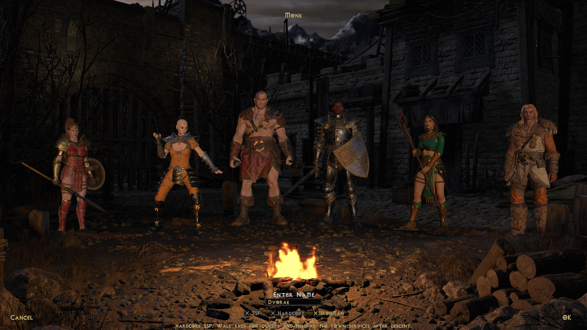](screenshots/ironman.jpg) | [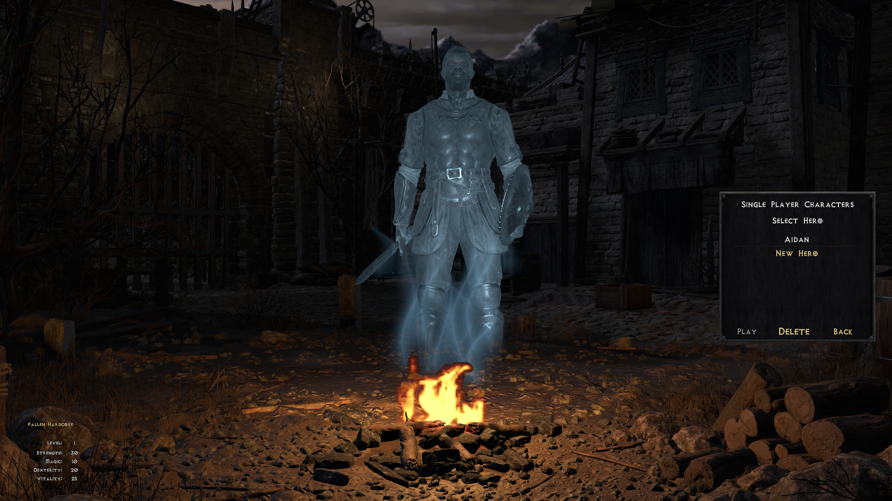](screenshots/fallen.jpg) |

## Report a bug

Use the bug icon in the launcher or game to prepare a report. Review it, then share it in the [playtest Discord](https://discord.gg/EGKxgCJr6) or paste it into a **[new GitHub issue](https://github.com/WordhordHearth/Diablo-Resurrected/issues/new)**. Include your class, dungeon floor, graphics mode, and what you were doing when it happened. For visual problems, **F4** takes a screenshot. Occasional hitches in lava areas are a known playtest issue.
